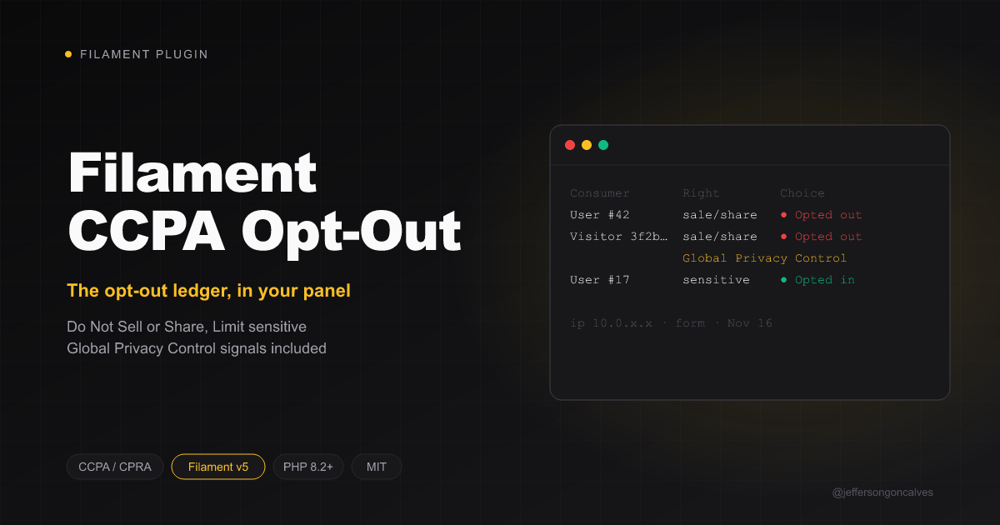

<div class="filament-hidden">



</div>

# Filament CCPA Opt-Out

[](https://packagist.org/packages/jeffersongoncalves/filament-ccpa-opt-out)
[](https://github.com/jeffersongoncalves/filament-ccpa-opt-out/actions?query=workflow%3Atests+branch%3A2.x)
[](https://github.com/jeffersongoncalves/filament-ccpa-opt-out/actions?query=workflow%3A"Fix+PHP+code+styling"+branch%3A2.x)
[](https://packagist.org/packages/jeffersongoncalves/filament-ccpa-opt-out)
[](LICENSE.md)

Browse the opt-out ledger of [laravel-ccpa-opt-out](https://github.com/jeffersongoncalves/laravel-ccpa-opt-out) from your Filament panel. Each row is one choice: an opt-out of the sale or sharing of personal information (Cal. Civ. Code §1798.120), a request to limit the use of sensitive personal information (§1798.121), or an opt-in back. The record shows who chose, which right, when, from where (IP address, user agent, source) and its metadata.

## Features

- Choices of users and of visitors without an account, including those a Global Privacy Control signal made (Regulations §7025).
- Filters by right, choice (opted out or opted in), visitors and Global Privacy Control.
- Read-only, like the ledger itself: there is no create, edit or delete.
- 19 languages.

## Compatibility

| Plugin Version                                                              | Filament |
|-----------------------------------------------------------------------------|----------|
| [1.x](https://github.com/jeffersongoncalves/filament-ccpa-opt-out/tree/1.x) | 3.x      |
| [2.x](https://github.com/jeffersongoncalves/filament-ccpa-opt-out/tree/2.x) | 4.x      |
| [3.x](https://github.com/jeffersongoncalves/filament-ccpa-opt-out/tree/3.x) | 5.x      |

## Installation

You can install the package via composer:

```bash
composer require jeffersongoncalves/filament-ccpa-opt-out:"^2.0"
php artisan vendor:publish --tag="ccpa-opt-out-migrations"
php artisan migrate
```

## Usage

```php
use JeffersonGoncalves\Filament\CcpaOptOut\CcpaOptOutPlugin;

public function panel(Panel $panel): Panel
{
    return $panel
        ->plugins([
            CcpaOptOutPlugin::make()
                ->navigationGroup('CCPA')             // default: no group
                ->navigationSort(20)
                ->navigationIcon('heroicon-o-hand-thumb-up')
                ->slug('opt-outs'),
        ]);
}
```

All fluent methods are optional. Purposes and their current terms version are configured in laravel-ccpa-opt-out's `ccpa-opt-out` config.

> The resource has no authorization of its own: register it only on panels whose users may see opt-out records, or add a policy for `JeffersonGoncalves\CcpaOptOut\Models\OptOutRecord`.

## Related plugins

- [filament-ccpa](https://github.com/jeffersongoncalves/filament-ccpa): personal data inventory.
- [filament-ccpa-dsar](https://github.com/jeffersongoncalves/filament-ccpa-dsar): data subject requests (Arts. 15 to 22).

## Testing

```bash
composer test
```

## Changelog

Please see [CHANGELOG](CHANGELOG.md) for more information on what has changed recently.

## Contributing

Please see [CONTRIBUTING](.github/CONTRIBUTING.md) for details.

## Security Vulnerabilities

Please review [our security policy](../../security/policy) on how to report security vulnerabilities.

## Credits

- [Jefferson Gonçalves](https://github.com/jeffersongoncalves)
- [All Contributors](../../contributors)

## License

The MIT License (MIT). Please see [License File](LICENSE.md) for more information.
